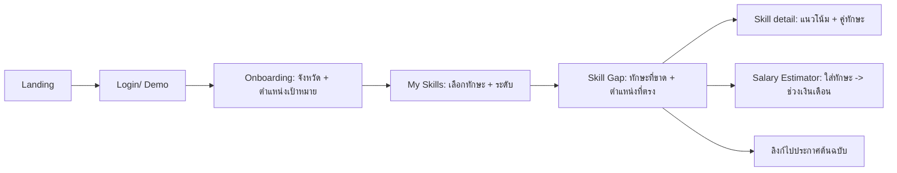
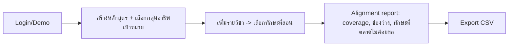

# FRONTEND_SPEC.md — สเปกหน้าเว็บ (Skill Demand Intelligence v4)

> ใช้คู่กับ [DESIGN_SYSTEM.md](DESIGN_SYSTEM.md) (สไตล์ Liquid Glass, กราฟ), [ARCHITECTURE.md](ARCHITECTURE.md) (ตาราง/ API), [CONTEXT.md](CONTEXT.md) (กติกา)
> **กติกาแสดงผลทุกหน้า:** แสดงเฉพาะ **aggregate** (n ≥ 5) + ลิงก์ไปประกาศต้นฉบับ ไม่แสดงเนื้อหาประกาศ · ทุกการ์ดมี `ProvenanceBadge` (แหล่ง, n, อัปเดตเมื่อ, "ตัวอย่างจากประกาศ")

---

## 1. Sitemap / Routes

| Route | หน้า | บทบาท | ลำดับความสำคัญ |
|---|---|---|---|
| `/` | Landing (public): ภาพรวมตลาด 4 KPI + calendar + ปุ่มเริ่มใช้ + ปุ่มเดโม | ทุกคน | Must |
| `/login`, `/signup` | เข้าสู่ระบบ + **ปุ่มเดโมคลิกเดียว 4 persona** | ทุกคน | Must |
| `/onboarding` | เลือกบทบาท, จังหวัด, ตำแหน่งเป้าหมาย, เลือกทักษะเริ่มต้น | Student/Institution | Must |
| `/market` | Market Explorer (ทักษะ/แนวโน้ม/ภูมิภาค) | ทุกคน | Must |
| `/occupations/[slug]` | Occupation detail | ทุกคน | Must |
| `/skills/[slug]` | Skill detail | ทุกคน | Must |
| `/salary` | Salary Explorer + Estimator (champion) | ทุกคน | Must |
| `/me/skills` | My Skills | Student | Must |
| `/me/gap` | Skill Gap + ตำแหน่งที่ตรง | Student | Must |
| `/institution/curricula` | รายการหลักสูตร | Institution | Must |
| `/institution/curricula/[id]` | จับรายวิชา→ทักษะ + Alignment report | Institution | Must |
| `/ml-lab` | ML Lab leaderboard | ทุกคน | Must |
| `/admin/pipeline` | รอบ scrape | Admin | Must |
| `/admin/quality` | Data quality | Admin | Must |
| `/admin/taxonomy` | Alias review queue + จัดการทักษะ | Admin | Must |
| `/admin/sources` | แหล่งข้อมูล, สถานะ ToS/การอนุญาต | Admin | Should |
| `/settings` | ภาษา, glass on/off, ลบข้อมูล | ผู้ล็อกอิน | Must |
| `/privacy`, `/about` | privacy notice, ที่มา/ข้อจำกัดข้อมูล | ทุกคน | Must |

Layout: `AppShell` = sidebar (glass-strong) + Global Context Bar (หน้าที่ใช้ตัวกรอง) + เนื้อหา + `ChatFab`; route ที่ต้องล็อกอินใช้ middleware ตรวจ session/role

---

## 2. User flows

### 2.1 Student

1. เข้า `/` → ล็อกอิน/กดเดโม → onboarding (เลือกตำแหน่งเป้าหมาย)
2. `/me/skills` ค้นหา/เพิ่มทักษะ (พิมพ์ไทยหรืออังกฤษ ค้นผ่าน alias) → บันทึกอัตโนมัติ
3. `/me/gap` เห็น coverage %, ทักษะที่ขาดเรียงตาม "สัดส่วนประกาศที่ขอ", ตำแหน่งที่ตรง
4. กดทักษะที่ขาด → `/skills/[slug]` ดูแนวโน้ม ทักษะคู่ และเงินเดือนที่เกี่ยวข้อง
5. `/salary` ประมาณเงินเดือนด้วย champion model → เห็นว่าทักษะใดเพิ่มช่วงเงินเดือน
6. กด "ดูประกาศต้นฉบับ ↗" ไปเว็บ JobThai

### 2.2 Institution

1. `/institution/curricula` → "สร้างหลักสูตร" (ชื่อ + กลุ่มอาชีพเป้าหมาย 1–3 กลุ่ม)
2. ในหลักสูตร เพิ่มรายวิชา (ชื่อ) แล้วติดแท็กทักษะ (SkillChipPicker) หรือ **นำเข้า CSV** (`course,skill`)
3. ดู Alignment: coverage %, ทักษะที่ตลาดขอสูงแต่ไม่มี (Gaps), ทักษะที่สอนแต่ตลาดขอน้อย (Over-coverage) · *(Should, T5.16)* เทียบ 2 หลักสูตร
4. Export CSV · *(Should, T5.16)* PDF

### 2.3 Admin
1. `/admin/pipeline` ดูรอบล่าสุด, สถานะ (done/stopped_403…), จำนวนที่ดึง
2. `/admin/quality` ดูผล check ผ่าน/ไม่ผ่าน + แนวโน้มราย run
3. `/admin/taxonomy` เปิดคิว alias pending (คำถี่ที่ยังไม่ map) → approve/reject/merge → กดรัน re-map (สั่ง job ฝั่ง pipeline ผ่านไฟล์สั่ง/ flag ใน DB ไม่ต้องรัน Python บน Vercel)
4. ดู "คำถามยอดนิยมจากแชท" ในหน้า pipeline

### 2.4 กรรมการ (Demo)
ปุ่มบน `/login`: **นักศึกษาสาย Data**, **นักศึกษาสาย Accounting**, **อาจารย์หลักสูตร (มีหลักสูตรตัวอย่างพร้อม)**, **Admin** → เข้าระบบทันทีพร้อมข้อมูล seed

---

## 3. สเปกรายหน้า

รูปแบบ: **Inputs → Outputs / ข้อมูลจาก → กราฟ → สถานะ (empty / loading / error)** — กราฟอ้างถึงการ์ดใน DESIGN_SYSTEM.md หัวข้อ 6

### 3.1 `/` Landing
- **Outputs:** 4 KPI (ประกาศที่วิเคราะห์ / ระบุเงินเดือน / ทักษะที่ map ได้ / อัปเดตล่าสุด), Posting Calendar (#8), top 10 ทักษะ (ranked bars), ปุ่ม "ดูตลาดทักษะ", "เข้าสู่ระบบ", "ลองเดโม", ข้อความข้อจำกัดข้อมูล
- **ข้อมูล:** `mart.posting_volume_daily`, `mart.skill_demand_weekly`, `mart.public_summary` (view สาธารณะ — ไม่อ่าน `mart.pipeline_status` ซึ่งเป็นของ admin)
- **สถานะ:** loading = คงภาพ+opacity; empty = "ยังไม่มีข้อมูลใน mart" + ลิงก์ `/about`; error = banner + ปุ่มลองใหม่

### 3.2 `/market` Market Explorer
- **Inputs:** ตัวกรอง จังหวัด/ภาค, กลุ่มอาชีพ, ช่วงเวลา, ประเภททักษะ (tool/technical/soft/language), `RangeSlider` ช่วงเวลา
- **Outputs/การ์ด:** KPI ×4 · Skill Ranking (ranked bars, #6) · Skill Flow (Sankey, #1) · Small multiples ทักษะที่เลือก ≤ 6 (#4) · Posting Volume + range slider (#7) · Calendar (#8)
- **ข้อมูล:** `mart.skill_demand_weekly`, `mart.posting_volume_daily`
- **การคำนวณ:** สัดส่วน "% ประกาศที่ขอทักษะ" เป็นค่าถ่วงน้ำหนัก `sample_weight` (ARCH §3.4); แนวโน้มเป็น **รายสัปดาห์** พร้อมป้าย "ช่วงเก็บข้อมูล: …–…" และเลือกได้ว่าดู "ประกาศ active" หรือ "ประกาศใหม่"
- **ปฏิสัมพันธ์:** คลิกแท่งทักษะ → `/skills/[slug]`; ปุ่ม "ดูเป็นตาราง"/"ดาวน์โหลด CSV ของข้อมูลที่แสดง (aggregate)"
- **สถานะ:** n < 5 → `LowDataState` ต่อการ์ด; ไม่มีผลตามตัวกรอง → "ไม่พบข้อมูล ลองขยายตัวกรอง"

### 3.3 `/occupations/[slug]`
- **Outputs:** ชื่อกลุ่มอาชีพ + จำนวนประกาศ, Skill Ranking ของตำแหน่ง (#6), Salary Range Ladder แยกตามประสบการณ์ (#3), การกระจายวุฒิ/ประสบการณ์ที่ขอ (stacked bar), ตัวอย่างชื่อตำแหน่งที่รวมในกลุ่มนี้ (ชื่อสั้นเท่านั้น + `SourceLink` ≤ 5)
- **ข้อมูล:** `mart.occupation_skill_profile`, `mart.salary_stats`, `mart.top_links`
- **สถานะ:** ไม่มีเงินเดือนพอ (n<5) → ซ่อน ladder แสดงข้อความ

### 3.4 `/skills/[slug]`
- **Outputs:** คำอธิบายทักษะ + alias ที่พบ (ไทย/อังกฤษ), Skill Demand Trend (#2), ตำแหน่งที่ขอทักษะนี้มากสุด (ranked bars), Co-occurrence top 15, เงินเดือนเมื่อมีทักษะนี้เทียบไม่มี (range) , ปุ่ม "เพิ่มเข้าทักษะของฉัน"
- **ข้อมูล:** `mart.skill_demand_weekly`, `mart.skill_cooccurrence`, `mart.occupation_skill_profile`, `mart.salary_stats`

### 3.5 `/salary` Salary Explorer + Estimator
- **Inputs (Estimator):** กลุ่มอาชีพ, จังหวัด/ภาค, ประสบการณ์ (band), วุฒิ, ประเภทการจ้าง, ทักษะ (SkillChipPicker, ดึงจาก My Skills ได้) — **ไม่มีช่องเพศ/อายุ**
- **Outputs:** Champion Card (gradient): ช่วงเงินเดือนที่คาด (p25–p75), ชื่อโมเดล champion + MAE/MAPE จาก CV, ข้อความ disclaimer; Salary Range Ladder ของกลุ่มที่เลือก (#3); meter list "ทักษะที่ถ้าเพิ่มแล้วค่าคาดเพิ่มขึ้น" (คำนวณโดยเรียกโมเดลซ้ำโดยเพิ่มทักษะทีละตัว); ลิงก์ไปหน้า ML Lab
- **ข้อมูล/API:** `POST /api/salary/estimate` (proxy → FastAPI ml-api ของ champion, timeout 8 วินาที; เปิดหน้าแล้วยิง `/health` ปลุกก่อน); fallback `mart.salary_prediction`; สถิติ `mart.salary_stats` · meter list ใช้ `/predict/batch` ครั้งเดียว
- **สถานะ:** ไม่ครบฟิลด์ → ปุ่มปิด + ข้อความ; โมเดลไม่ตอบ → ใช้ median ของกลุ่ม + ป้าย "ค่าสถิติ ไม่ใช่ค่าจากโมเดล"; ผลอยู่นอกช่วงข้อมูลที่เทรน (n น้อย) → เตือน

### 3.6 `/me/skills` My Skills (Student)
- **Inputs:** ค้นหา/เพิ่ม/ลบทักษะ, ระดับ 1–3 (พื้นฐาน/ใช้งานได้/ชำนาญ)
- **Outputs:** รายการทักษะ + ชิปกลุ่ม; ข้อเสนอ "ทักษะที่คนในตำแหน่งเป้าหมายมักมี" (suggest)
- **ข้อมูล:** `app_user_skill` (RLS), `dw.dim_skill` ผ่าน view/RPC สาธารณะ
- **สถานะ:** empty = ปุ่ม "เริ่มจากทักษะแนะนำของตำแหน่ง"; error บันทึก = toast + retry

### 3.7 `/me/gap` Skill Gap
- **Inputs:** ตำแหน่งเป้าหมาย (กลุ่มอาชีพ), จังหวัด (ไม่บังคับ), เกณฑ์ "ทักษะสำคัญ" (≥ x% ของประกาศ, ค่าเริ่มต้น 20%)
- **Outputs:** Radar ฉัน vs ตลาด (#5), tile coverage % + จำนวนทักษะที่ขาด, ทักษะที่ควรเพิ่ม (ranked bars เรียงตามสัดส่วนประกาศ), ตำแหน่งที่ตรง = ชื่อกลุ่มอาชีพ/ตำแหน่งยอดนิยม + `match %` + `SourceLink` ไปรายการต้นฉบับ
- **ข้อมูล:** `app_user_skill`, `mart.occupation_skill_profile`, `mart.top_links`
- **การคำนวณ:** `coverage = Σ(w_s · 1[s ∈ ผู้ใช้]) / Σ w_s` โดย `w_s` = สัดส่วนประกาศของตำแหน่งนั้นที่ขอทักษะ s (top 30)
- **สถานะ:** ยังไม่มีทักษะ → พาไป `/me/skills`

### 3.8 `/institution/curricula` และ `/[id]`
- **Inputs:** ชื่อหลักสูตร, กลุ่มอาชีพเป้าหมาย, รายวิชา + ทักษะที่สอน (หรือ CSV), เกณฑ์ top-K ทักษะของตลาด (ค่าเริ่มต้น 30)
- **Outputs:** Coverage meter (#10), ตาราง Gaps (ทักษะตลาดขอสูง–หลักสูตรไม่มี), Over-coverage (หลักสูตรสอน–ตลาดขอน้อย), แผนที่รายวิชา×ทักษะ (heatmap), ปุ่ม Export CSV · *(Should, T5.16)* เทียบหลักสูตร 2 อัน, Export PDF
- **ข้อมูล:** `app_curriculum`, `app_curriculum_skill` (RLS), `mart.curriculum_coverage_ref`
- **สถานะ:** หลักสูตรไม่มีรายวิชา → wizard 3 ขั้น; export ล้มเหลว → toast

### 3.9 `/ml-lab`
- **Outputs:** Leaderboard (5 โมเดล + baseline: R², RMSE, MAE, MAPE ค่าเฉลี่ย ± SD), แท่ง RMSE + error bar, strip plot ราย fold, feature importance ของ champion, Champion Card, อธิบายวิธีวัดผล (GroupKFold ตามบริษัท, ไม่ใช้เพศ/อายุ), จำนวนแถวที่ใช้, วันที่เทรน
- **ข้อมูล:** `mart.ml_leaderboard`, `ml.feature_importance` (ผ่าน view)
- **หมายเหตุ:** แสดงชัดว่า "ระบบจริงใช้เฉพาะ champion"

### 3.10 `/admin/pipeline`
- **Outputs:** ตารางรอบ scrape (แหล่ง, ขอบเขต, เริ่ม–จบ, สถานะ, ดึงได้/ล้มเหลว), กราฟประกาศใหม่รายวัน, ธง `stopped_403/429/captcha` เด่นชัด, คำถามยอดนิยมจากแชท
- **ข้อมูล:** `mart.pipeline_status`, `app_chat_log`
- **สถานะ:** ไม่มี run → "ยังไม่เคยรัน"

### 3.11 `/admin/quality`
- **Outputs:** ตาราง check (completeness, validity, uniqueness, consistency, freshness, taxonomy, compliance) พร้อม pass/fail + ค่า, แนวโน้มต่อรอบ, % ประกาศที่ map ทักษะได้, precision จากชุดตรวจมือ 200 ประกาศ
- **ข้อมูล:** `mart.dq_summary`

### 3.12 `/admin/taxonomy`
- **Inputs:** คิว alias pending (คำ, ความถี่, ตัวอย่างบริบทสั้น ≤ 120 ตัวอักษรจากข้อความ (ภายใน admin เท่านั้น), ทักษะที่กฎเสนอ (alias ที่คล้ายที่สุดจาก `pg_trgm similarity` — **ไม่ใช้ AI/LLM**, ข้อ D7)), ปุ่ม approve / reject / map ไปทักษะอื่น / สร้างทักษะใหม่; แก้ไข alias; ผูกทักษะกับ O*NET/ESCO ref
- **Outputs:** จำนวน alias, ทักษะ, % ครอบคลุม
- **ข้อมูล:** `dw.skill_alias`, `dw.dim_skill` ผ่าน RPC เฉพาะ admin
- **หมายเหตุ:** ตัวอย่างบริบทแสดงเฉพาะใน admin ไม่ใช่หน้าสาธารณะ

### 3.13 `/admin/sources`
- ตารางแหล่ง (JobThai, JobBKK), robots/ToS สรุป, สถานะหนังสืออนุญาต (กรอกวันที่), รายการแหล่งต้องห้าม (JobTopGun, JobsDB, Indeed)

### 3.14 `/settings`, `/privacy`, `/about`
- Settings: ภาษา TH/EN, Glass on/off, ลบทักษะ/ลบบัญชี; Privacy: ข้อมูลที่เก็บ, การส่งข้อมูลบนหน้าให้ Google (Gemini); About: แหล่งข้อมูล, ข้อจำกัด (ตัวอย่างไม่ใช่ census, selection bias ของเงินเดือน), ลิงก์ไปเอกสารโครงงาน

---

## 4. แชท Gemini ลอย (ทุกหน้า)

| หัวข้อ | สเปก |
|---|---|
| UI | `ChatFab` มุมขวาล่าง (✦ gradient) → `ChatPanel` (glass-strong) บนมือถือเป็น bottom sheet เต็มจอ; ปิดด้วย Esc/ปุ่ม; เก็บประวัติเฉพาะ session (ไม่ข้ามหน้าเมื่อเปลี่ยนบริบท: ขึ้นข้อความ "เปลี่ยนหน้าแล้ว บริบทใหม่") |
| Behaviour | ทุกหน้าเรียก `usePageContext()` ลงทะเบียน `pageContext` ของหน้าปัจจุบัน; ส่งไปพร้อมคำถามเท่านั้น; ตอบไทย; อ้างชื่อการ์ด; ไม่แต่งตัวเลข |
| Disclaimer | "คำตอบจาก AI ใช้เฉพาะข้อมูลบนหน้านี้ อาจคลาดเคลื่อน ตรวจจากการ์ดที่อ้างถึง" + แจ้งว่าข้อมูลบนหน้าส่งให้ Google |
| Rate limit | ล็อกอิน 20/วัน, visitor 5/วัน/IP → ข้อความ "ใช้โควตาวันนี้ครบแล้ว" |
| ปุ่มคำถามแนะนำ | ตามหน้า (ตารางล่าง) |
| สถานะ | typing indicator; error → "ตอบไม่ได้ในตอนนี้" + ปุ่มลองใหม่; ถ้าคำถามไม่เกี่ยวกับข้อมูลบนหน้า → แนะนำหน้าที่เกี่ยวข้อง (ลิงก์) |

| หน้า | pageContext ประกอบด้วย | ตัวอย่างคำถามแนะนำ |
|---|---|---|
| `/market` | ตัวกรอง, KPI, top 20 ทักษะ (ชื่อ, % ประกาศ), series รายสัปดาห์ของทักษะที่เลือก, n | "ทักษะไหนโตเร็วสุดในช่วงนี้", "ภาคใต้ต่างจากทั้งประเทศอย่างไร" |
| `/occupations/*` | ชื่อกลุ่ม, n, top 20 ทักษะ, salary p25/50/75, วุฒิ/ประสบการณ์ | "ตำแหน่งนี้ควรเรียนทักษะอะไรก่อน" |
| `/skills/*` | ชื่อทักษะ, trend, co-occurrence top 15, ตำแหน่งที่ขอ, salary เทียบ | "ทักษะนี้มักมาคู่กับอะไร" |
| `/salary` | อินพุตของผู้ใช้, ช่วงค่าคาด, โมเดล+MAE, ladder, meter list | "ทำไมช่วงเงินเดือนกว้างขนาดนี้", "เพิ่มทักษะไหนคุ้มสุด" |
| `/me/gap` | ทักษะของผู้ใช้ (ชื่อ+ระดับ), ตำแหน่งเป้าหมาย, coverage, ทักษะที่ขาด top 15, ตำแหน่งที่ตรง | "ควรเริ่มเรียนอะไรก่อน" |
| `/institution/curricula/*` | ชื่อหลักสูตร, coverage, gaps top 15, over-coverage top 10 | "หลักสูตรขาดทักษะสำคัญอะไร" |
| `/ml-lab` | ตาราง leaderboard, champion, จำนวนแถว, วิธีวัด | "ทำไมเลือกโมเดลนี้", "baseline คืออะไร" |
| `/admin/*` | สรุป run/DQ/คิว alias (ตัวเลขรวม) | "check ไหนไม่ผ่าน" |

---

## 5. Responsive / Mobile
- Breakpoint: `< 768` มือถือ, `768–1199` แท็บเล็ต (กริด 8 คอลัมน์), `≥ 1200` เดสก์ท็อป (12 คอลัมน์)
- มือถือ: sidebar → bottom tab bar (Market / Skills / Salary / ฉัน); Context Bar → ปุ่ม "ตัวกรอง" เปิด sheet; KPI เลื่อนแนวนอน; การ์ดเรียงตามความสำคัญ; ตารางเลื่อนแนวนอนหรือเป็น card-list; Sankey/Radar ย่อเป็น ranked bars/ตารางเมื่อกว้าง < 420px
- ลด blur บนมือถือ (DESIGN_SYSTEM 3.4); ไม่โหลดกราฟนอกจอจนกว่าเลื่อนถึง (lazy)

## 6. Accessibility
ตาม DESIGN_SYSTEM.md หัวข้อ 8: contrast ≥ 4.5:1, table view ทุกกราฟ, keyboard ครบ (ชิปทักษะ, slider, แชท), focus ring ชัดเจน, `aria-live` สำหรับคำตอบแชทและ toast, ไม่สื่อด้วยสีอย่างเดียว, เคารพ reduced-motion/transparency/contrast

## 7. i18n TH/EN
- `next-intl` (หรือเทียบเท่า): ไฟล์ `messages/th.json`, `en.json`; ค่าเริ่มต้น **ไทย**; สลับที่ Settings/มุมขวาบน
- ชื่อทักษะแสดงตามภาษา (`skill_name_th` / `skill_canonical`) พร้อมค้นด้วยทั้งสองภาษา
- รูปแบบเลข/วันที่: ปี พ.ศ. ในภาษาไทย, ค.ศ. ในภาษาอังกฤษ; สกุลเงินบาท
- ข้อความแชทตอบตามภาษาที่ผู้ใช้เลือก

## 8. เกณฑ์ตรวจรับหน้า (Definition of Done ระดับหน้า)
1. แสดงข้อมูลจริงจาก mart (ไม่ hardcode) + มี 3 สถานะ (loading/empty/error)
2. ทุกกราฟมี table view, tooltip, `aria-label`
3. ไม่มีเนื้อหาประกาศ; ลิงก์ต้นฉบับทำงาน
4. ลงทะเบียน `pageContext` และถามแชท 3 คำถามตัวอย่างได้คำตอบตรงกับตัวเลขบนหน้า
5. ใช้ได้ที่ 375px และ 1280px; ผ่านการตรวจ contrast
